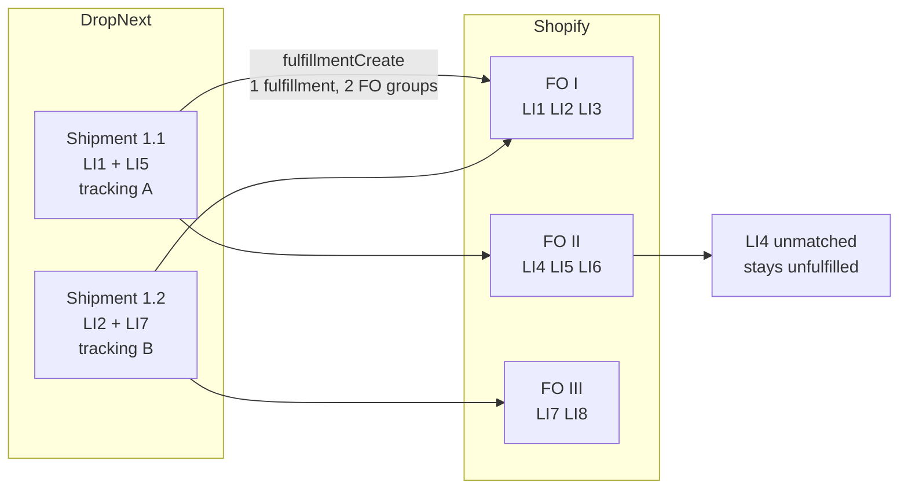
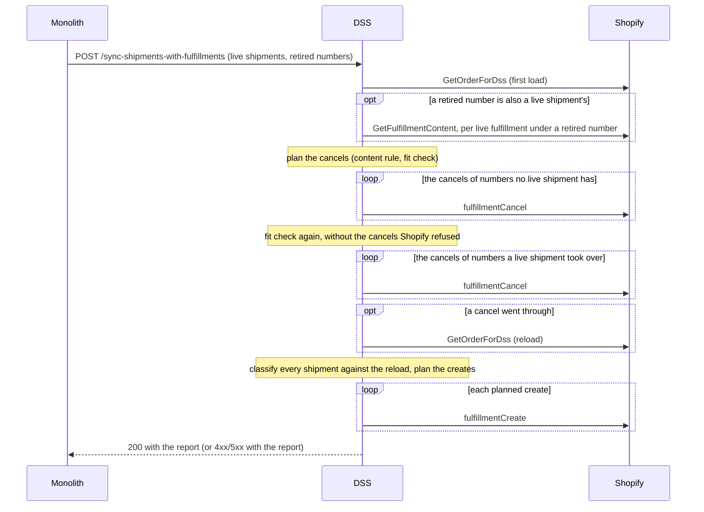

# Fulfillment verification (DSS)

How a supplier's shipment becomes a Shopify fulfillment, through the monolith → DSS path, and how to verify it on a
real shop. The DSS does not call the Supplier API; the monolith bridges supplier events to the DSS routes defined in
the contract spec, [`src/resources/monolith-dss-openapi.json`](../src/resources/monolith-dss-openapi.json). The
monolith's half (what it sends, when, and the one-off backfill) is in its `docs/shopify-fulfillment-sync.md`.

Until DropNext sends its own shipping emails and runs its own tracking page, Shopify does both, so the order's
fulfillments mirror the order's shipments as closely as Shopify allows. The mirror is best effort: a shipment Shopify
has no room for stays out of it, and the next run tries again.

## Glossary

| Term | Meaning |
|------|---------|
| **Supplier order** | A monolith-side order sent to a supplier for fulfillment. It may be shipped in several packages over time. |
| **Shipment** | A physical package with one tracking number and a set of `(product_variant_id, quantity)` lines, sent in `SyncShipmentsWithFulfillmentsRequest.shipments[]`. |
| **Live shipment** | A shipment the monolith has not retired. Every run sends all of them, mirrored or not. |
| **Retired shipment** | A shipment that stopped being a package: replaced by a split, lost, damaged, returned, canceled, or holding a tracking number that was corrected. The monolith never sends it. |
| **Retired tracking number** | A tracking number of a retired shipment, sent in `retired_tracking_numbers[]`. It may be a live shipment's number too, when a split reuses it. |
| **Content** | What one package holds, as the quantity per variant: of a shipment, from its lines; of a fulfillment, from its fulfillment line items (`GetFulfillmentContent`). |
| **Line item** | A row on the Shopify order or on a fulfillment order, identified in this flow by `product_variant_id` (the Shopify variant's `legacyResourceId`). |
| **Fulfillment order** | Shopify's unit of fulfillment work; an order can have several (for example one per location). Only an `OPEN` or `IN_PROGRESS` fulfillment order accepts a new fulfillment; Shopify closes one when it is completed. |
| **Fulfillment** | A Shopify fulfillment with tracking info. The DSS creates one per live shipment that fits whole, holding all of its lines, and cancels the ones under retired tracking numbers that no live shipment matches. |
| **Fulfillment-order line item** | A line of a fulfillment order. `remainingQuantity` is live (already reduced by existing fulfillments) and is what matching consumes. |

DropNext shipments and Shopify fulfillment orders are independent groupings. A shipment whose lines sit on two
fulfillment orders becomes one Shopify fulfillment whose line items are grouped by fulfillment order, not one
fulfillment per fulfillment order. A line of the order that no shipment names stays unfulfilled:



## Prerequisites

- The shop granted the access scopes the install requests (listed in the README, "Shopify Partner app"); a shop installed before that list changed opens the install link again first.
- Monolith and DSS both hold `MONOLITH_TO_DSS_API_KEY`: the monolith sends it as `Authorization: Bearer <MONOLITH_TO_DSS_API_KEY>` on `POST /sync-shipments-with-fulfillments`, `POST /tracking-update`, and `PUT /stores/api-key`; the matching auth guard is the `authenticate(MONOLITH_WEBHOOK_AUTH)` route block.
- Shopify Admin token resolvable for the shop — complete OAuth or have the monolith persist one via `PUT /stores/api-key` (a miss falls back to `MonolithService.getStore`).
- `MONOLITH_BASE_URL` set on DSS for order/product webhooks (Shopify → monolith).

## Path reference

| Monolith intent | DSS URL | Request body |
|-----------------|---------|--------------|
| The shipments of an order changed (created, split, retired, tracking number corrected) | `POST /sync-shipments-with-fulfillments` | `SyncShipmentsWithFulfillmentsRequest` |
| Carrier tracking status (e.g. AfterShip) | `POST /tracking-update` | `TrackingUpdateRequest` |

## How a sync runs

The request carries the whole state of one order: every live shipment, and the tracking numbers of the retired ones.
`syncShopifyShipmentsToFulfillments` reconciles the order's fulfillments with it.



In words:

```
validate the request
  → load the order
  → load the content of the live fulfillments whose number is retired and live at once
    (only when there is one; then also those under the other retired numbers)
  → plan the cancels against the first load, then send them in two waves:
    the fulfillments of numbers no live shipment has, then the fit check again without the ones Shopify refused,
    then the fulfillments a live shipment took over with another content
    (a cancel Shopify refuses is reported and the next one sent; any other failure stops the run)
  → if a cancel went through, load the order again
  → classify every shipment against that order, counting the fulfillments this run canceled as canceled:
      its number is on a stale fulfillment that was kept or whose cancel was refused  → blocked
      else its number is on a live fulfillment                                        → already fulfilled
      else                                                                            → a create candidate
  → match the candidates, the ones the order already carried under their number first, then the others,
    each group in request order
  → one fulfillmentCreate per matched shipment
    (a create Shopify refuses is reported and the next one sent; any other failure stops the run)
  → answer the report
```

The creates are planned against the order as it is after the cancels, because Shopify puts canceled units on
fulfillment orders that may not exist before the cancel. Shopify's documentation of `fulfillmentCancel`: "When you
cancel a fulfillment, the system creates new fulfillment orders for the cancelled items so they can be fulfilled
again. If a fulfillment order was entirely fulfilled, then it automatically closes. If a fulfillment order is
partially fulfilled, then the remaining quantities adjust to include the cancelled items."

A run makes no Shopify call it could not finish within `SHIPMENT_SYNC_BUDGET` (25 s, counted from the arrival of the
request, under the 30 s the monolith waits); it stops as `502` with the report instead. Without that, the monolith's
retry would start a second run while the first still creates.

### The cancel rule

A live fulfillment that carries a retired tracking number is canceled, unless a live shipment with that number has
exactly its content.

A split retires every live shipment of a supplier order and creates new ones, one per tracking number that gets
units, so a tracking number usually comes back with other lines:

```
before the split   shipment A   T1   2 × X, 1 × Y   live, mirrored as fulfillment F1 (T1: 2 × X, 1 × Y)
after the split    shipment A   T1   2 × X, 1 × Y   retired
                   shipment B   T1   2 × X          live
                   shipment C   T2   1 × Y          live
```

The run after the split sends `shipments = [B, C]` and `retired_tracking_numbers = [T1]`. F1 carries T1, and its
content differs from B's, so F1 is canceled (`content_changed`), the order is reloaded, and B and C are created. Every
later run sends T1 as retired again; by then the live fulfillment under T1 is B's, with B's content, and it stays. A
split that leaves a package as it was cancels nothing for it, and its tracking events survive. A number no live
shipment has any more (a lost package, a corrected tracking number) has its fulfillment canceled as `retired`.

The details:

- A fulfillment is decided once. It is kept when a live shipment with one of its retired numbers has its content.
- Only a fulfillment made by hand carries two tracking numbers, and canceling it would guess which package it holds.
  So one that also carries the number of a live shipment that was never retired is kept, and so is one whose two
  retired numbers both came back on live shipments; both are logged at `warn`, and the shipments under their numbers
  are reported `already_fulfilled` by them.
- A fulfillment whose content cannot be read whole (more than 100 lines, a line without a variant) matches nothing and
  gives back no room, so it is replaced only when its shipment fits the room the order already has, and kept otherwise.
  One that Shopify no longer has cannot be canceled either — Shopify keeps a canceled fulfillment, so this is an
  anomaly rather than a deletion — so it stays in the way of its number: the shipment is reported `blocked` and a
  `warn` line names the fulfillment.
- **The fit check.** A `content_changed` cancel is sent only if the shipments that are counting on the room still fit.
  The demand is every live shipment whose number Shopify has carried and that has no fulfillment left to hold it: the
  shipment that took a number over in this run, and the ones whose fulfillment was canceled by an earlier run or by the
  merchant. In request order, each takes its content out of the first load's open room plus what the planned cancels
  give back, per variant. The first that does not fit and has a cancel of its own drops it: the stale fulfillment is
  kept, with its tracking events, and the shipment is reported `blocked`, because an outdated package in Shopify is
  better than one gone from it. Each run checks again. A shipment Shopify has never carried is not counted: it has
  waited for room before.
- **Two waves.** The cancels of numbers no live shipment has go first, since their units are the room the others count
  on; then the fit check runs again without the ones Shopify refused, and the rest are sent. So a refused cancel costs
  no other shipment its fulfillment.
- A shipment whose number the order carried on any fulfillment is matched before the others, whatever became of that
  fulfillment: Shopify has shown that package to the customer. It is the complement of the notification rule, and it
  holds in the run that cancels and in every retry after it.
- The DSS cancels only fulfillments under a retired tracking number. A fulfillment made by hand under another number is
  never touched.

### The matching rules

- Duplicate `product_variant_id` rows within one shipment are summed first.
- A line matches the open fulfillment-order lines of the same variant. It is taken from the one with the most left
  once the plan so far is honored, the first in Graphql order on a tie, and from the next only what that one cannot
  serve: a quantity one line can take stays on one line, a larger one is spread over several (on one fulfillment order
  or on several, all in the shipment's one fulfillment).
- A shipment is filed whole or skipped whole: a fulfillment is a package, never part of one. A line whose variant is
  on none of the order's line items skips its shipment as `not_on_order`; a line that asks for more than the variant's
  open lines have left together, counting what the shipments matched before it claimed, skips it as `no_room` (a
  closed fulfillment order or one on hold has nothing open). `not_on_order` wins when both apply.
- A skipped shipment claims nothing, so a later shipment can still fit. Nothing is ever refused for a quantity: a
  supplier may ship more than was ordered (a re-ship, an over-shipment). The shipment is sent again with every later
  run, so it becomes a fulfillment once there is room.
- Tracking numbers are trimmed and compared case-sensitively. A shipment whose number is on a live fulfillment is not
  matched at all, which makes the monolith's re-send of the whole state safe.

### Who gets an email

A fulfillment is created with `notifyCustomer = true` when the order carried its tracking number on no fulfillment,
whatever its status, before the run. The customer gets Shopify's shipping email once per new tracking number: none for
a split's reused number, none for a fulfillment re-created under a number they already had, one for a corrected
tracking number. Whether Shopify sends it also depends on the store's notification settings.

## The answer

Every finished run answers **200** with one entry per shipment of the request, in request order, under the tracking
number exactly as it was sent, and one entry per cancel the run decided on, in the order sent:

```json
{
  "shipments": [
    { "tracking_number": "T1", "outcome": "created", "fulfillment_id": 6001 },
    { "tracking_number": "T2", "outcome": "created", "fulfillment_id": 6002 },
    { "tracking_number": "T0", "outcome": "skipped", "skip_reason": "no_room" }
  ],
  "cancellations": [
    { "tracking_number": "T1", "fulfillment_id": 8001, "outcome": "canceled" }
  ]
}
```

| Shipment `outcome` | Meaning |
|--------------------|---------|
| `created` | This run created its fulfillment (`fulfillment_id`). |
| `already_fulfilled` | A live fulfillment carries its tracking number (`fulfillment_id`). |
| `skipped` | It does not fit whole: `skip_reason` `no_room` or `not_on_order`. |
| `blocked` | Its number is on a stale fulfillment that was kept or whose cancel was refused (`fulfillment_id`). |
| `refused` | Shopify refused the create; its messages are in the DSS log. |
| `failed` | Reaching Shopify failed on its create, and the run stopped there. |
| `not_attempted` | The run stopped before it got to this shipment. |

A cancellation is `canceled`, `refused`, `failed` or `not_attempted`, with the same meanings. Its `tracking_number` is
the retired number, trimmed; a shipment's is echoed exactly as the request spelled it. `fulfillment_id` and
`skip_reason` are left out when they do not apply.

| Situation | HTTP |
|-----------|------|
| A finished run, whatever its outcomes (skipped, blocked and refused included), an empty `shipments` list included | **200** with the report |
| An invalid request: a malformed body, missing fields, a non-positive `shopify_order_id`, an invalid `shopify_subdomain`, a duplicate `tracking_number`, a blank retired tracking number | **400** with the plain error body (`error`, `trace_id`) |
| No resolvable Shopify Admin token for the shop | **401** (or **502** when the monolith could not be asked for it), plain error body |
| The order is unknown to Shopify | **404** with the report |
| Shopify rejects the token mid-run | **401** with the report |
| Shopify throttles | **429** with the report, `retry_after_seconds` and `Retry-After` |
| An order larger than the order query loads | **500** with the report |
| Shopify is unreachable, answers a `5xx` or a Graphql error, or the run would outlive its budget | **502** with the report |

A stopped run's report says what landed: the cancels and creates before the stop, the one that failed, and
`not_attempted` for the rest. A stop before the creates were planned (the first load, a content load, a cancel, the
reload) reports every shipment `not_attempted`. Retired tracking numbers equal after trimming are one; an absent or
`null` `retired_tracking_numbers` is none.

**What a retry does.** The monolith sends the same state again. The retry finds the canceled fulfillments `CANCELLED`
and plans no cancel for them, finds the created ones by their tracking numbers (`already_fulfilled`), and creates what
is missing. A shipment whose fulfillment the stopped run canceled is still matched first, because the order carries its
number on that canceled fulfillment.

## Step A — Order ingest (Shopify → monolith)

1. Place a test order on the staging shop (variant-backed line items).
2. Confirm DSS logs: webhook verified → `Monolith create order accepted`.
3. Confirm the monolith order has the correct `product_variant_id` on each line.

## Step B — Supplier shipment → Shopify fulfillment

1. Create a supplier shipment in the monolith for that order.
2. The monolith POSTs to `{DSS_URL}/sync-shipments-with-fulfillments` with a body like:

```json
{
  "shopify_subdomain": "acme-downtown",
  "shopify_order_id": 1001,
  "shipments": [{
    "tracking_number": "1Z999AA10123456784",
    "carrier": "UPS",
    "tracking_url": "https://www.ups.com/track?tracknum=1Z999AA10123456784",
    "line_items": [{ "product_variant_id": 101, "quantity": 1 }]
  }],
  "retired_tracking_numbers": []
}
```

3. Expect **HTTP 200** and the shipment reported `created` with its `fulfillment_id`.
4. In Shopify Admin: the order shows the fulfillment with its tracking; the shipment's line items are fulfilled. With
   the store's shipping notifications on, the customer receives the "Shipping confirmation" email.

## Step C — Tracking event (AfterShip-style)

1. The monolith POSTs to `{DSS_URL}/tracking-update` with the **same** `tracking_number` as step B:

```json
{
  "shopify_subdomain": "acme-downtown",
  "shopify_order_id": 1001,
  "tracking_number": "1Z999AA10123456784",
  "status": "in_transit",
  "happened_at": "2026-04-02T08:30:00Z"
}
```

2. Expect **HTTP 200** and `fulfillment_event_id`.
3. The Shopify fulfillment timeline shows the event (e.g. in transit).
4. A tracking number on none of the order's live fulfillments → **404** (the monolith logs it at `warn` and drops it);
   an unsupported `status` → **400**. The monolith forwards events of live shipments only.

## Manual checklist

Each on the staging shop, with the store's shipping notifications on.

1. **Incremental shipment** — ship one item, later a second → the first fulfillment stays, a second is created, two
   emails.
2. **Re-send** — trigger a sync for an order whose shipments are all mirrored (retire nothing, change nothing) →
   **200**, every shipment `already_fulfilled`, nothing created, no email.
3. **Over-shipment** — a shipment with more units than the order has open → **200**, `skipped` with `no_room`, the
   existing fulfillments untouched; `reason=no_room` in the DSS log.
4. **Variant not on the order** — a shipment with a bogus variant → **200**, `skipped` with `not_on_order`, nothing of
   it created; `reason=not_on_order` at `warn`.
5. **Cross-FO shipment** — one shipment spanning two fulfillment orders → one fulfillment, both fulfillment orders
   reflected.
6. **A split that reuses a number** — split a mirrored shipment so its number keeps part of the items and a pending
   number gets the rest → the old fulfillment is canceled, two fulfillments are created, one email (for the new
   number); `sync-shipments cancel … reason=content_changed` in the log. Check how the canceled units came back (a new
   fulfillment order, or remaining quantities adjusted on an existing one).
7. **A split that keeps a number** — split so the existing number keeps exactly its items → that fulfillment is
   untouched (its tracking events stay), only the new number's fulfillment is created.
8. **A lost package without a replacement** — retire a mirrored shipment as lost in the supplier portal → its
   fulfillment is canceled (`reason=retired`), the units show as unfulfilled.
9. **A lost package with a replacement** — retire it, then add the replacement shipment under a new number → cancel,
   then create, one email.
10. **A resend accepted on a dispute** — accept a resend on a shipment dispute with "retire the disputed shipment" on,
    then add the resend's shipment → as check 9.
11. **A corrected tracking number** — correct a mirrored shipment's number through the supplier API → the fulfillment
    under the wrong number is canceled, one under the right number is created, one email.
12. **A refused cancel** — retire a shipment whose package Shopify shows as delivered → if Shopify refuses, the
    cancellation is `refused`, the shipment under that number (if any) `blocked`, the refusal at `error`; every later
    run tries again.
13. **A merchant's manual cancel** — cancel a mirrored fulfillment in the Shopify admin → the next sync of the order
    creates it again, without an email.
14. **A replacement that does not fit** — split so a reused number gets more units than the order has → the stale
    fulfillment stays, the shipment is `blocked`; `kept stale fulfillment … reason=replacement_does_not_fit` at `warn`.
15. **A refused cancel beside a reused number** — retire one package Shopify will not let go of (check 12) while
    another number is reused with more units → the refused cancel is reported, and the reused number keeps its own
    fulfillment instead of losing it to a cancel whose room never came.

## Log lines

One summary line per sync, at `info` when the run finished and at `warn` when it stopped:

```
sync-shipments orderId=1001 created=2 alreadyFulfilled=0 skipped=1 blocked=0 refused=0 canceled=1 cancelRefused=0 notified=1 stoppedBy=none fulfillmentIds=[6001, 6002]
```

`stoppedBy` names the failure that stopped the run (`shopify_http_503`, `shopify_not_found`, `shopify_timed_out`, …).
Beside it, each at the level given:

| Line | Level |
|------|-------|
| `sync-shipments cancel orderId=… tracking=… fulfillmentId=… reason=retired` (or `reason=content_changed`) | `info` |
| `sync-shipments kept stale fulfillment orderId=… tracking=… fulfillmentId=… reason=replacement_does_not_fit short=[variant=…:asked=…:available=…]` | `warn` |
| `sync-shipments kept stale fulfillment orderId=… tracking=… fulfillmentId=… reason=carries_live_tracking_number liveTracking=[…]` | `warn` |
| `sync-shipments kept stale fulfillment orderId=… tracking=… fulfillmentId=… reason=carries_two_reused_tracking_numbers liveTracking=[…]` | `warn` |
| `sync-shipments content unknown orderId=… fulfillmentId=… error=…` (more lines than one page) | `warn` |
| `Fulfillment content unknown fulfillmentId=… reason=line_without_variant_or_quantity` | `warn` |
| `sync-shipments fulfillment gone orderId=… fulfillmentId=…` | `warn` |
| `sync-shipments cancel refused orderId=… tracking=… fulfillmentId=… error=…` (Shopify's messages) | `error` |
| `sync-shipments create refused orderId=… tracking=… error=…` (Shopify's messages) | `error` |
| `sync-shipments skipped shipment orderId=… tracking=… reason=already_fulfilled fulfillmentIds=[…]` | `info` for one fulfillment, `warn` for several (a duplicate for a human) |
| `sync-shipments skipped shipment orderId=… tracking=… reason=no_room short=[variant=…:asked=…:available=…]` | `info` (expected: a re-ship, an over-shipment, units fulfilled by hand) |
| `sync-shipments skipped shipment orderId=… tracking=… reason=not_on_order short=[…]` | `warn` (the monolith named a variant the order does not have) |
| `sync-shipments skipped shipment orderId=… tracking=… reason=blocked fulfillmentId=…` | `warn` |

Shopify webhooks (Step A) are answered `200` when a redelivery could not do better and `502` when Shopify or the
monolith did not answer, throttled, or answered a `5xx`. Every verified delivery logs one
`Webhook done topic=… webhook_id=… outcome=… answered=…` line: `info` for mirrored and skipped, `warn` for a transient
failure, `error` for a permanent one. Shopify redelivers a failed delivery up to eight times in four hours and removes
the subscription after repeated failures within 24 hours
([Shopify: troubleshoot webhooks](https://shopify.dev/docs/apps/build/webhooks/troubleshooting-webhooks));
`GET /api/check?shop=…` (bearer auth) shows whether each handled topic is still subscribed.

## Known limitations

- `GetOrderForDss` loads at most 100 line items and 50 fulfillment orders with 100 lines each, and an order past any of
  them fails the call (`500`) instead of being matched against a partial snapshot. `fulfillments` is not a connection:
  it is loaded at 250 and truncates silently, so a tracking number on the two-hundred-and-fifty-first fulfillment is not
  found.
- A canceled fulfillment's tracking events are lost with it; the fulfillment created in its place starts without them.
- A cancel Shopify refuses is attempted again on every run of the order, and logged at `error` each time.
- A fulfillment a merchant cancels by hand is created again by the next run: the monolith is the source of truth.
- Matching is by variant only; the location of a fulfillment order is not looked at.
- `/tracking-update` trims the tracking number, compares it case-sensitively, ignores canceled fulfillments, and takes
  the first live fulfillment that carries it.

## Automated tests in this repo

```sh
./gradlew test
```

Covers the fulfillment path end to end: request validation, the content comparison and the cancel plan, the open-line
index and fulfillment-order matching, the `calculate` → `determine` → `effect` planning, the time budget, the Shopify
Graphql wire format for every operation the sync uses, and `POST /sync-shipments-with-fulfillments` and
`POST /tracking-update` through the production application module. The manual checks above are for what only a real
shop can show: that Shopify accepts the mutations, how it puts canceled units back, and what the merchant and the
customer see.
